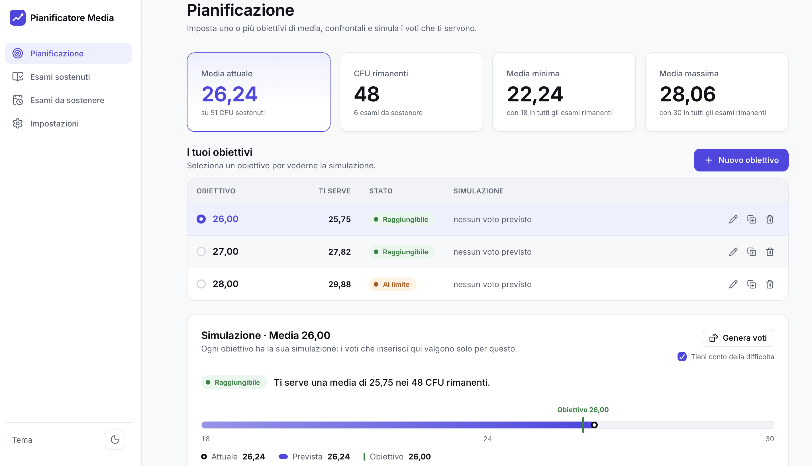

# Pianificatore Media

**Prova l'app: https://titanotan.github.io/pianificatore-media/**

<picture>
  <source media="(prefers-color-scheme: dark)" srcset="docs/screenshot-pianificazione-scuro.png">
  
</picture>

App web per tenere sotto controllo la media universitaria. Non è un semplice libretto: il cuore
dell'app è capire **quali voti servono nei prossimi esami** per raggiungere la media obiettivo.

## Come è stato sviluppato

Il progetto è un esperimento con Claude Code. Io ho definito il problema, i requisiti, le priorità
e le scelte di prodotto, e ho provato e revisionato ogni milestone; il codice è stato scritto in
gran parte da Claude Code. I requisiti iniziali sono in
[`docs/requisiti-iniziali.md`](docs/requisiti-iniziali.md); l'app nel frattempo si è evoluta e le
funzionalità attuali sono descritte qui sotto.

## Funzionalità

- **Libretto**: esami sostenuti con CFU, voto, lode e data; media ponderata in tempo reale.
- **Esami da sostenere** con CFU e difficoltà prevista.
- **Più obiettivi di media** (es. 25, 26, 27) confrontati in una tabella: per ognuno la media
  necessaria negli esami rimanenti e lo stato (già raggiunto, raggiungibile, al limite, solo con
  lodi, non raggiungibile).
- **Simulazione per ogni obiettivo**: voto previsto, lode e lucchetto per ogni esame futuro;
  barra 18–30 con media attuale, prevista e obiettivo; voto suggerito nei campi vuoti.
- **Genera voti**: proposta realistica dei voti negli esami non bloccati, facoltativamente in base
  alla difficoltà.
- **Gruppo di esami** (funzione aggiuntiva): pagina propria con obiettivi e simulazioni calcolati
  solo su un gruppo ristretto di esami (es. quelli che l'ateneo usa per i punti di laurea).
- Valore della lode configurabile (30–33), tema chiaro/scuro, uso da computer e smartphone,
  schermata iniziale con esempio da caricare.

## Tecnologie

- [React](https://react.dev) + [TypeScript](https://www.typescriptlang.org), con [Vite](https://vite.dev)
- [Vitest](https://vitest.dev) per i test della logica di calcolo
- CSS Modules con variabili CSS per il tema chiaro e scuro
- Dati salvati nel browser (`localStorage`): nessun server, nessun account

## Comandi

Serve Node.js 22.12 o superiore (consigliato il 26, indicato in `.nvmrc`).

```bash
npm install        # installa le dipendenze (una volta)
npm run dev        # avvia l'app in locale → http://localhost:5173
npm test           # esegue i test
npm run build      # crea il sito statico in dist/
npm run preview    # prova in locale il sito appena costruito
npm run lint       # controlla il codice
npm run format     # formatta il codice con Prettier
```

## Accessibilità

Tutte le pagine sono state controllate con [axe-core](https://github.com/dequelabs/axe-core)
rispetto ai criteri WCAG 2.1 AA, in tema chiaro e scuro, su computer e smartphone, senza errori
rilevati. Gli strumenti automatici individuano solo una parte dei possibili problemi: segnalazioni
da chi usa tecnologie assistive sono benvenute.

## Struttura

```
src/
  domain/      logica di calcolo pura (medie, obiettivo, simulazione, validazione), con test
  storage/     salvataggio in localStorage con versione dello schema e migrazioni, con test
  state/       stato dell'app (reducer + provider React), con test
  app/         struttura della pagina, navigazione (#/piano, #/libretto, ...), tema
  components/  componenti grafici riutilizzabili
  features/    le sezioni dell'app (pianificazione, gruppo, libretto, esami futuri, impostazioni)
  styles/      token di design (colori, spaziature) e stili di base
```

## Regole di calcolo

- **Media ponderata** = Σ(voto × CFU) / Σ CFU. Con la lode un 30 vale quanto impostato (30–33).
- **Obiettivi**: una o più medie da 18 a 30 (massimo 10), ognuna con la sua simulazione
  indipendente; si confrontano in una tabella e si possono duplicare.
- **Media necessaria** negli esami futuri non bloccati =
  (obiettivo × CFU totali − Σ voti sostenuti − Σ voti bloccati) / CFU non bloccati.
- **Stato dell'obiettivo**: già raggiunto (basta 18 ovunque) · raggiungibile · al limite (serve
  29 o più) · solo con lodi (serve più di 30) · impossibile.
- **Gruppo di esami** (funzione aggiuntiva, da attivare in Impostazioni): una pagina propria nel
  menu, con più obiettivi e simulazioni calcolati solo sugli esami del gruppo, che restano anche
  nella media generale.
- **Media finale prevista**: calcolata solo sugli esami con un voto, cioè quelli sostenuti più
  quelli futuri con un voto previsto. Gli esami futuri senza voto previsto non vengono contati.
- La media necessaria è mostrata arrotondata per eccesso, per non sottostimare ciò che serve.
- **Genera voti** (`src/domain/distribution.ts`): propone voti interi 18–30 negli esami non
  bloccati partendo dalla media necessaria, con uno scostamento per difficoltà (facile +1,5,
  difficile −1,5) e una variazione casuale; poi corregge i voti finché la media raggiunge
  l'obiettivo senza eccedere. I voti bloccati non cambiano; la lode non viene generata.

## Limitazioni

- **I dati restano solo nel browser** in cui li hai inseriti: non si sincronizzano tra
  dispositivi e vanno persi se cancelli i dati di navigazione del sito o usi una finestra in
  incognito.
- **Genera voti è casuale**: ogni volta propone una combinazione diversa. È uno spunto per
  pianificare, non una previsione.
- **Le regole del voto di laurea cambiano da ateneo ad ateneo** (valore della lode, esami esclusi,
  bonus): l'app calcola medie ponderate e non sostituisce le regole ufficiali del tuo corso di
  studi.

## Prossimi passi

- Esportazione e importazione dei dati in un file JSON, per fare un backup e spostarli su un altro
  dispositivo.

## Pubblicazione su GitHub Pages

Il workflow [`.github/workflows/deploy.yml`](.github/workflows/deploy.yml) esegue lint, test e
build e pubblica il sito a ogni push su `main`. La prima volta, nel repository GitHub, vai in
**Settings → Pages → Source** e scegli **GitHub Actions**.

## Avanzamento

- [x] M0 — Fondamenta: progetto, temi chiaro/scuro, navigazione, deploy
- [x] M1 — Logica di calcolo e salvataggio
- [x] M2 — Libretto e impostazioni
- [x] M3 — Esami futuri e obiettivo
- [x] M4 — Pianificazione con più obiettivi e simulazione
- [x] M5 — Gruppo di esami (funzione aggiuntiva)
- [x] M6 — Pagina del gruppo con più obiettivi
- [x] M7 — Voti casuali in base alla difficoltà
- [x] M8 — Primo avvio, rifiniture, accessibilità e pubblicazione su GitHub Pages

## Licenza

[MIT](LICENSE) © 2026 Alberto Sina
